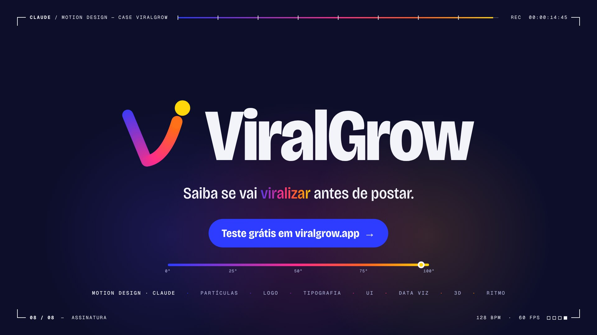

# ViralGrow: identidade, landing page e filme de 15 s

ViralGrow é uma marca conceitual: um termômetro que lê o gancho, o ritmo, o áudio e o horário de um vídeo curto e dá uma temperatura de 0 a 100° antes de ele ser postado.

**[▶ reel/viralgrow-motion-case-2026.mp4](reel/viralgrow-motion-case-2026.mp4)** · 1920×1080 · 60 fps · estéreo



## Identidade

| | |
|---|---|
| Marca | Um V cujo braço direito é uma curva de crescimento, terminando numa faísca. O traço esquenta de cobalto a laranja e a faísca é amarela. |
| Cor | Escala térmica `#2D3CFF → #FF2E88 → #FF6A1A → #FFD60A`, sobre noite `#0C0E2A` e papel `#F3F4FA`. |
| Tipo | Bricolage Grotesque (display, eixos de largura e peso) e Geist Mono (dados e rótulos). |
| Ideia | Tudo é medido em graus. A régua 0–100° aparece na landing, no medidor do produto e na assinatura do filme. |

## Landing page

[`landing/index.html`](landing/index.html) é uma página única, responsiva, com tema claro e escuro.

## O filme

Toda a imagem vem de código. Não há keyframes, vídeo de referência nem imagens; só as duas fontes. Cada quadro é `REEL.renderFrame(ctx, t)`, uma função pura do tempo desenhada num canvas 2D. A trilha é sintetizada em numpy.

A 128 BPM, 15 s são 32 tempos (8 compassos). Cada cena ocupa um compasso e mostra uma habilidade de motion design:

| t | Cena | O que mostra |
|---|---|---|
| 0.000 | 01 Partículas | Um post se divide como célula (pescoço de metaball) em 1 → 2 → 4 … 1.048.576 views, cada geração mais rápida. O mostrador 0–100° esquenta junto. |
| 1.875 | 02 Logo | No drop, o enxame voa até o traço do V e o desenha (trim path com gradiente térmico). A faísca estoura no tempo seguinte e a marca vai para a assinatura. A câmera entra na faísca. |
| 3.750 | 03 Tipografia | “SEU VÍDEO / TEM UMA / TEMPERATURA” com reenquadramentos de câmera. Um líquido sobe e o fundo esquenta enquanto o contador vai de 0° a 97°. |
| 5.625 | 04 UI | Match cut: o anel do “°” se abre no medidor do produto. Os cards entram com spring, o cursor agenda o post e o clique vira a próxima cena. |
| 7.500 | 05 Data viz | Curva exponencial de views. A escala se multiplica por 10 a cada tempo, e a câmera mergulha na ponta da curva. |
| 9.375 | 06 3D | A ponta da curva vira São Paulo num globo de pontos. Uma frente de calor se espalha e arcos levam o vídeo de cidade em cidade. |
| 11.250 | 07 Ritmo | Seis cortes que aceleram (0,94 s → 0,12 s). |
| 13.125 | 08 Assinatura | Marca, chamada para ação e créditos. |

No acabamento entram motion blur de 12 amostras (obturador de 180°, sem integrar através de cortes), aberração cromática nos cortes, tremor de câmera por lista de impactos e granulação no encode.

### Build

```sh
cd reel
npm install            # playwright (Chromium headless)
pip install numpy scipy pillow
./build.sh             # trilha → 900 quadros → viralgrow-motion-case-2026.mp4  (~2 min)
SAMPLES=1 ./build.sh   # prévia rápida sem motion blur
```

O `ffmpeg` vem do `PATH`. Se não estiver lá, o build usa `imageio-ffmpeg`.

Para assistir ao vivo, sirva a pasta `viralgrow/` (por exemplo `npx serve .`) e abra `reel/index.html`. **Espaço** toca e pausa, **← / →** avançam um quadro e um clique navega. `?t=9.4` abre num instante específico.

### Arquivos

- `reel/reel.js`: as cenas, o HUD e o compositor
- `reel/audio.py`: a trilha e o design de som
- `reel/render.mjs`: renderizador offline em paralelo (Playwright)
- `reel/index.html`: player ao vivo e harness de render
- `fonts/`: Bricolage Grotesque e Geist Mono, ambas sob a SIL Open Font License
