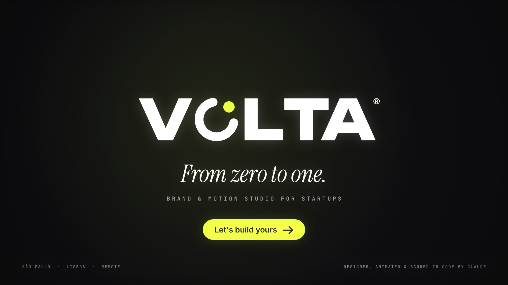

# VOLTA® — Showreel 2026

Showreel de 30 segundos de uma agência fictícia de branding e motion para startups.
**[▶ volta-showreel-2026.mp4](volta-showreel-2026.mp4)** · 1920×1080 · 60 fps · estéreo · −15 LUFS



Tudo foi feito do zero, em código. Não há imagens, vídeos, keyframes ou samples.
Cada frame é uma função pura do tempo (`V.renderFrame(ctx, t)`) desenhada num canvas 2D.
A trilha é sintetizada em numpy. Só as fontes vêm de fora, todas do Google Fonts (SIL Open Font License).

## O conceito

> *Toda startup começa no zero.*

A marca da VOLTA é um anel que dá três quartos de volta, com um **ponto** no espaço que fica aberto: a ideia.
Esse ponto atravessa o filme inteiro. Ele abre o reel como um cursor, vira o **0**, que se transforma em **1**,
e aí vira a marca da agência. Depois passa de cliente em cliente por match cuts, até fechar o filme de novo.

## A montagem (120 BPM, todos os cortes no tempo)

| t | Cena | O que mostra |
|---|---|---|
| 0.0 | Intro | "Every startup starts at **0**". O ponto anda como cursor e infla até virar o zero. A câmera mergulha dentro dele. |
| 2.0 | 0 → 1 | O anel se desenrola num "1" com antecipação, overshoot e anotações que mudam de valor. Depois colapsa de volta no ponto. |
| 4.0 | VOLTA | Construção do logo com grid de construção e cotas. A marca vira o "O" do wordmark e as letras saem de trás dela. |
| 6.0 | 01 FLOWPAY · fintech | Uma onda atravessa o quadro e uma moeda se fecha em volta dela. Depois: cartão em 3D com perspectiva real e reflexo, app com saldo em slot machine, gráfico, feed e um toast de pagamento. O check de sucesso vira o prato da próxima marca. |
| 10.0 | 02 MUNCH · delivery | Um rosto-prato leva uma mordida (com farelos). As letras caem com squash & stretch. Na cidade em flat design, a rota se desenha, a moto acompanha a curva de velocidade, o ETA conta até zero e há stickers e confete. A cena fecha com um iris out até um ponto. |
| 14.0 | 03 NIMBUS · IA | O ponto explode em 2.400 partículas: esfera, blob com ruído 3D e rede neural, e então o wordmark escrito em partículas. Um prompt "gera" um sistema de marca. As partículas viram o planeta da próxima cena. |
| 18.0 | 04 TERRA · clima | Globo pontilhado com continentes procedurais. Ele inclina até ficar de perfil, e as linhas de latitude viram as listras do logo do sol. Ao fundo, curvas topográficas geradas por marching squares. Em primeiro plano, um contador e barras que crescem como plantas. |
| 22.0 | Brand systems | Oito cortes de ¼ de tempo: logo wall, paletas, tipografia, ícones de app e "BRANDS / THAT / MOVE.", até a marca girando em 3D falso. |
| 24.0 | Impact | Números em slot machine e "Your startup is *next.*" com um marca-texto volt. |
| 26.0 | End card | O ponto cai, quica e o anel gira em volta dele. Fecha com "From zero to one." e o CTA. |

Os quatro clientes têm identidade completa: marca, paleta, tipografia e voz.

| Marca | Tipografia | Paleta |
|---|---|---|
| VOLTA | Unbounded · Instrument Serif · JetBrains Mono | `#0C0C0E` `#F4F1EA` `#D9FF3F` |
| Flowpay | Sora | `#5B2EFF` `#160A52` `#4DF0C0` `#B9A8FF` |
| Munch | Fredoka | `#FF4433` `#FFF1DA` `#FFC43B` `#2A160F` |
| Nimbus | Space Grotesk | `#05050A` `#8C6CFF` `#46E5FF` `#FF6BD6` |
| Terra | Fraunces | `#0E3A2B` `#EFE3C9` `#FF8A3D` `#7DB07A` |

## Técnicas

- **Motion blur real**: 12 sub-frames por frame (obturador de 180°).
- **3D falso com perspectiva verdadeira**: o cartão e o celular são texturas fatiadas em faixas verticais e projetadas uma a uma.
- **Partículas**: 2.400 pontos numa esfera de Fibonacci, com ruído de Perlin 3D, amostragem de glifos para formar texto, rede de vizinhos mais próximos e bloom em pós-processamento.
- **Gerativo**: continentes por fBm na esfera e curvas de nível por marching squares, animadas no tempo.
- **Path morphing**: anel → "1" → ponto, e check → sorriso, por reamostragem por comprimento de arco.
- **Acabamento**: camera shake e aberração cromática numa lista de impactos sincronizada com a música, vinheta e grão no encode.
- **Áudio**: kick, baixo, acordes, pads, marimba, sinos, risers, whooshes, a mordida, a moto e a digitação. Tudo é sintetizado, com sidechain do kick e reverb por convolução.

## Build

```sh
npm install                 # playwright (Chromium headless)
pip install numpy scipy pillow
./build.sh                  # trilha → 1800 frames → volta-showreel-2026.mp4  (~5 min)
SAMPLES=1 ./build.sh        # prévia rápida, sem motion blur
```

Para assistir ao vivo, sirva a pasta (`npx serve .`) e abra `index.html`.
**Espaço** dá play e pausa, **← / →** andam frame a frame e um clique pula para aquele ponto.

## Arquivos

- `src/core.js`: tempo, easing, ruído, tipografia, morphing, projeção 3D e numerais em slot machine
- `src/studio.js`: intro, 0 → 1, revelação da VOLTA e end card
- `src/flowpay.js` · `src/munch.js` · `src/nimbus.js` · `src/terra.js`: os quatro cases
- `src/finale.js`: montagem e números
- `src/compositor.js`: linha do tempo, HUD, shake, aberração cromática, bloom e motion blur
- `audio.py`: trilha e sound design
- `render.mjs`: renderizador offline em paralelo
- `fonts/`: Unbounded, Inter, Instrument Serif, JetBrains Mono, Sora, Fredoka, Space Grotesk e Fraunces (OFL)

*VOLTA, Flowpay, Munch, Nimbus e Terra são marcas fictícias criadas para este portfólio.*
